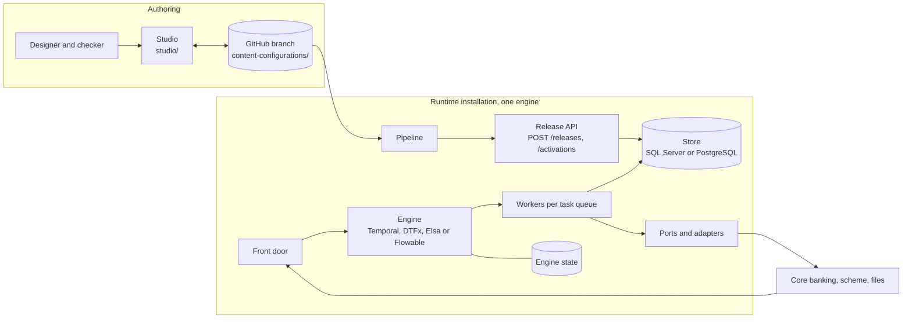

# System design overview

The north star as one picture, and where a new feature goes. It replaces the source's master design, system design and long design document. The decisions are in plan section 8; the detail per component is [components.md](components.md); the flows are [sequences.md](sequences.md).

## The picture

- The studio writes only to the branch. It has no connection to the runtime or to a running payment (R-10-01).
- The runtime reads only what was published to the branch and stored as a release.
- Each installation runs one engine (D1). The engine keeps its own state; the payments data is in the store.
- A bank enters only through its folder on the branch: configuration sets, hook bindings, port bindings.

## Where a feature goes

The source sorted services into domain buckets. The north star sorts content by scope and code by what it may know.

| The feature is | It goes | Example |
| --- | --- | --- |
| Behaviour every payment has, whatever the scheme | `p` content, authored in the studio; code-behind in the platform activities | Duplicate check, approval, funds, posting, reversal, notification |
| Behaviour of a cluster of schemes | `<cluster>.p` content | IBAN and routing code, AED, the UAE calendar |
| Behaviour of one scheme | `<cluster>.<scheme>` content: a leg in the lifecycle's slot | The WPS salary file leg, its file rules, its acknowledgements |
| Something one bank does differently | A value, a hook or a port binding in the bank's folder | A limit, an extra approval hook, its core-banking adapter |
| A connection to an outside system | A port, with one adapter per wire shape | `ICoreBanking`: `simulator`, `gateway-rest` |
| Persistence of payments | The store's one model | A new fact kind, not a new table per scheme |
| A way to run workflows | An engine binding behind `IEngine`, proved by the kit | A fifth engine would pass the same 55 scenarios |
| A designer's tool | The studio, with a spec requirement and a check | A new editor, a new check |

If a feature fits only by naming a bank in shared code, by adding a table for a scheme, or by editing a published release, it is in the wrong place.

## What the source had that the north star has no place for

| Source part | Why it has no place |
| --- | --- |
| A worker per bank, and activity forks per bank | A bank is configuration, hooks and port bindings (plan W6) |
| A schema per scheme and per bank | One store; scheme and tenant are columns (plan W2) |
| One generic workflow over JSON steps with patch markers | The studio's DSL, expanded, released and pinned (plans W3, W4) |
| A separate integration product with its own adaptor model | Ports and adapters bound per bank |
| An AI service that writes workflows outside review | The studio's assistant, behind the designer's gates and maker-checker (C16) |
| Change data capture into a report database | The outbox ([I-68](../../ISSUES.md#i-68-non-functional-targets-deployment-sizes-and-the-reporting-read-side)) |
| Hot reload of activity code in flight | Code is released and pinned; only values are hot |

## What is not decided

The operator surface ([I-65](../../ISSUES.md#i-65-the-runtimes-operator-surface-and-who-may-use-it)), observability ([I-66](../../ISSUES.md#i-66-observability-of-the-runtime-and-the-studio)), secrets and decryption ([I-67](../../ISSUES.md#i-67-secrets-keys-and-file-encryption-at-deployment)), targets and reports ([I-68](../../ISSUES.md#i-68-non-functional-targets-deployment-sizes-and-the-reporting-read-side)).
