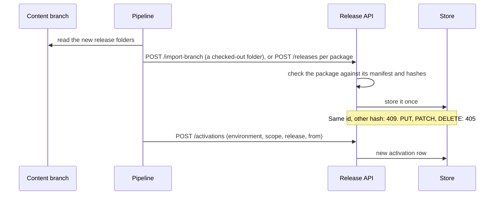
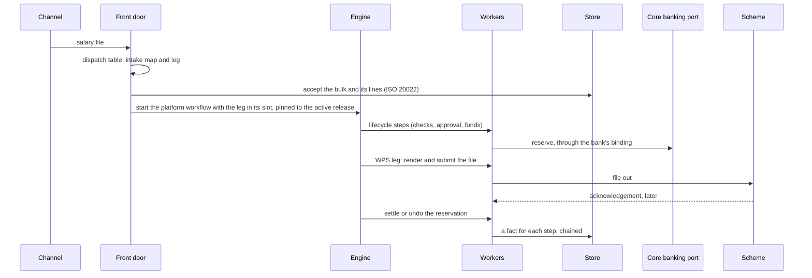
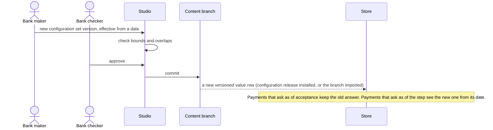

# Sequences

The flows that matter in the north star. They replace the source's sequence diagrams, which followed each scheme through its own services. Here every scheme takes the same path; only the leg differs.

## 1. Publishing a change set

```mermaid
sequenceDiagram
  actor M as Maker
  actor C as Checker
  participant S as Studio
  participant G as GitHub
  M->>S: save a draft
  S->>G: commit on branch studio/<change set id>
  M->>S: submit for review
  C->>S: approve
  S->>S: check every member with the others in place; run the tests that target them
  S->>G: one commit on the content branch (fast-forward only)
  Note over S,G: In pull-request mode: one commit on the change set's branch and a pull request
  S->>G: change set record and its hash-chained audit
```

- The checker is not the maker of any member (R-11-19).
- If the branch moved, the studio reads it again, checks again and retries once, then stops with a message (R-09-21). It never force-pushes.
- A file already published is never rewritten.

## 2. A release reaches the runtime



A package with simulators may be activated only in a test environment (`ReleaseApiTests`).

## 3. A salary file, end to end



- The workflow carries `PaymentContext` only. Activities read the payment from the store by id.
- The bank's hooks run at the hook points it bound; a hook unbound in a later configuration set is simply not called.
- The studio's black-box tests run this path on the interpreter and deployed on DTFx (`studio/test/blackbox/e2e-wps.test.ts`), and the runtime runs it on Temporal on SQL Server (`e2e-wps-temporal.test.ts`).

## 4. A rule value changes with no deployment



The store's side is proved by `StoreTests.A_payment_asking_as_of_its_acceptance_gets_the_same_answer_after_a_hot_update`. A bank's values reach the store as a signed configuration release the service console installs with a bank approver's consent, or through `POST /import-branch`, which stores the bank's own configuration set as effective-dated versions (`BankValues`, `e2e-p6-hot-update.test.ts`). The runtime reads a bank's port bindings from its folder (`BankFolderConfigurationTests`).

## 5. A bank changes its core banking

A new port binding with a later `validFrom` in the bank's folder. No release and no deployment. The example bank moves from `simulator` to `gateway-rest` on 2026-12-01 (`BankConfigurationTests.The_example_bank_switches_core_banking_by_a_binding_alone`).

## 6. An operator acts on a running payment

Retry, requeue, repair, cancel or decide, in the operations console, each as the payment's operations view declares it, with a second approver where the view names one (R-05-50). The operator signs in at the bank's identity provider; the decision is a fact and an `engine-signal` outbox row, which the engine host delivers (R-05-57). See [operations-console.md](operations-console.md).
